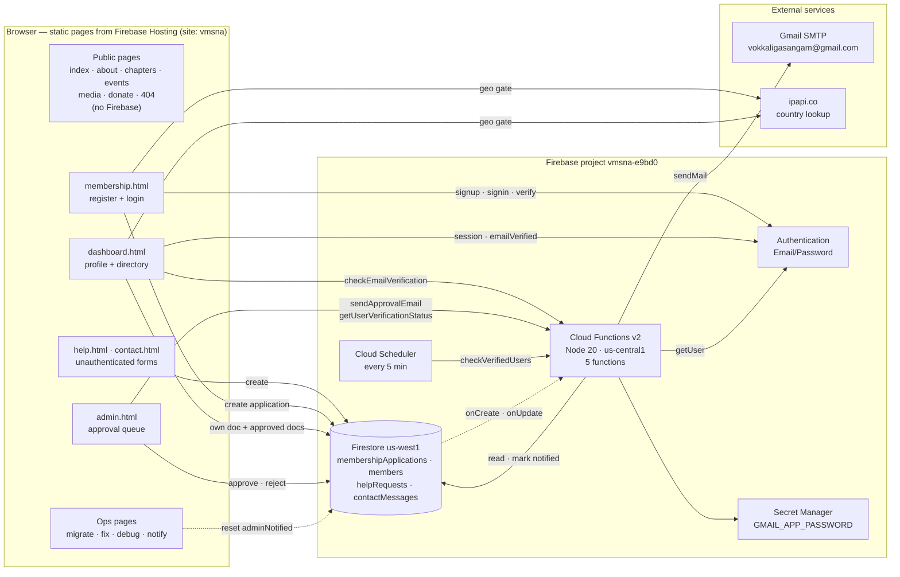
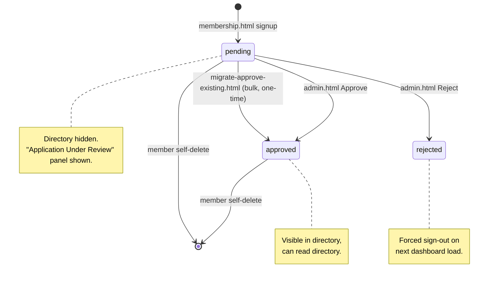
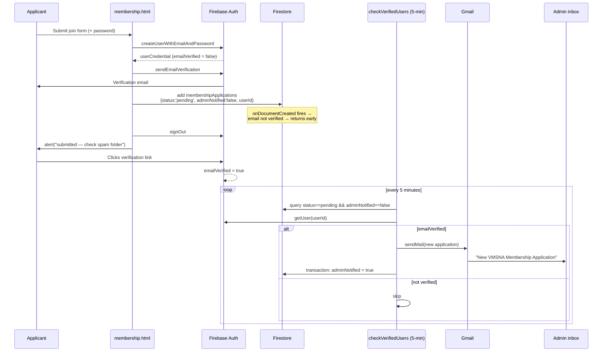
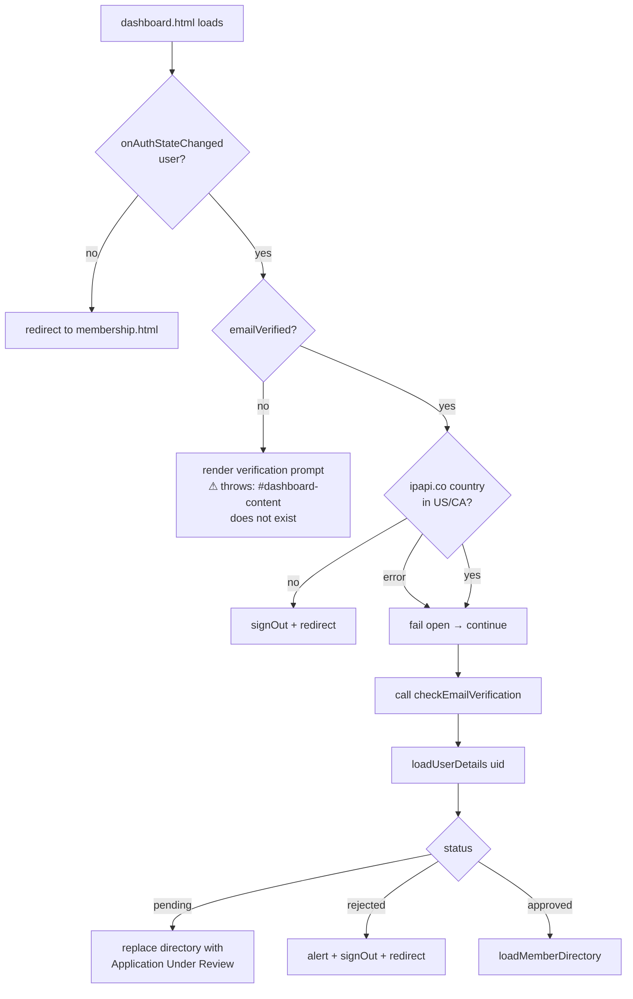

# VMSNA Website — Technical Design Document

**Application:** Vokkaliga Mahajana Sangam North America (VMSNA) community website
**Repository path:** `tvsna-website-dark-hero-fullsite/`
**Firebase project:** `vmsna-e9bd0` · **Hosting site:** `vmsna`
**Public URLs referenced in code:** `https://vmsna.org`, `https://www.vmsna.org`, `https://vmsna.web.app`
**Document status:** Baseline — reverse-engineered from the code at commit `194287b`
**Last updated:** 2026-09-21

---

## 1. Purpose and Scope

This document describes the architecture of the VMSNA website: every component it is
built from, every external service it integrates with, the data it stores, the security
model that protects that data, and the end-to-end flows that tie them together.

It is written to be sufficient for a new engineer to reason about a change without first
reading all 6,400 lines of source. Section 15 records the defects and risks that exist in
the current implementation, so the document describes the system **as built**, not as
idealised.

**In scope:** the static frontend, Firestore data model, Firebase Authentication usage,
Cloud Functions, the email notification subsystem, security rules, build/deploy, and the
operational one-off tooling committed to the repo.

**Out of scope:** the legacy `vokkaligasangam` Firebase project (referenced only by the
migration scripts), DNS/domain configuration, and the Gmail account's own administration.

---

## 2. System Overview

VMSNA is a volunteer-run non-profit. The site serves three audiences:

| Audience | Needs | Surface |
| --- | --- | --- |
| Public visitors | Learn about the org, find a local chapter, see events, donate, request welfare assistance, contact the org | `index`, `about`, `chapters`, `events`, `media`, `donate`, `help`, `contact` |
| Members | Apply for membership, verify email, view/edit their profile, search the member directory | `membership`, `dashboard` |
| Admins (13–14 named emails) | Review, approve or reject membership applications | `admin`, plus one-off operational pages |

The defining workflow is **gated membership**: anyone may apply, but a member cannot see
the member directory until (a) they verify their email address and (b) an admin approves
their application. Almost everything else in the system exists to support, notify, or
audit that gate.

There is **no application server and no build step for the frontend**. Every page is a
self-contained HTML file that talks directly to Firebase from the browser. The only
server-side code is a small set of Cloud Functions whose sole job is sending email.

---

## 3. Architecture

All pages are plain static files served by Firebase Hosting, and every dynamic page loads
the Firebase JS SDK 10.7.1 from `gstatic.com`. Those two edges are omitted below so the
data flows stay legible.



### 3.1 Architectural characteristics

- **Serverless / BaaS.** The browser is a first-class client of Firestore and Auth. There
  is no API tier, so **Firestore Security Rules are the only authorization boundary** for
  data access.
- **No shared frontend code.** Each page repeats the nav, footer, Firebase config object
  and menu-toggle script inline. There is no shared JS module, no template engine, and no
  `firebase-config.js`. Changing the Firebase config or the nav requires editing every page.
- **Email is the only server-side concern.** Cloud Functions exist because an SMTP
  password and the Admin SDK cannot be exposed to a browser.
- **Idempotency by flag.** All admin notifications converge on one boolean
  (`adminNotified`) guarded by a Firestore transaction, because three independent code
  paths can trigger the same email.

---

## 4. Component Inventory

Every component integrated with the application, why it is there, and where it is
configured.

### 4.1 Firebase / Google Cloud components

| Component | Role in the app | Configured in | Notes |
| --- | --- | --- | --- |
| **Firebase Hosting** | Serves the entire `public/` directory as static files | `firebase.json` → `hosting`, `.firebaserc` → target `main` | Site `vmsna`. No rewrites, no custom headers, no SPA fallback. `404.html` is served by Hosting convention. |
| **Cloud Firestore** | Primary datastore for applications, help requests, contact messages | `firebase.json`, `firestore.rules`, `firestore.indexes.json` | Database `(default)`, location `us-west1`. |
| **Firebase Authentication** | Identity: email/password sign-up, sign-in, email verification, password reset | Firebase console (not in repo) | Email/Password is the only provider used. No federated login, no MFA (see §15). |
| **Cloud Functions (2nd gen)** | Email notification subsystem; privileged Auth lookups | `functions/src/index.ts`, `functions/package.json`, `firebase.json` | Node 20, TypeScript, `maxInstances: 10` globally, region `us-central1`. |
| **Cloud Scheduler** | Fires `checkVerifiedUsers` every 5 minutes | `onSchedule` in `functions/src/index.ts` | Timezone `America/Los_Angeles`. Provisioned implicitly by the `onSchedule` trigger. |
| **Secret Manager** | Stores the Gmail app password | `secrets: ["GMAIL_APP_PASSWORD"]` on each function | Set via `firebase functions:secrets:set GMAIL_APP_PASSWORD`. |
| **Firebase Realtime Database** | **Not used.** | `database.rules.json` (`.read`/`.write` = false) | No `database` block in `firebase.json`, so these rules are never deployed. Vestigial. |
| **Firebase Data Connect** | **Not used.** | `dataconnect/dataconnect.yaml`, `dataconnect/schema/schema.gql` | Unmodified scaffold for a *music library* app (`Artist`, `Album`, `Track`, `Playlist`). Targets Cloud SQL `…-fdc` / `fdcdb` in `us-east4`. Should be deleted or implemented. |
| **Google Analytics** | **Not active.** | `measurementId: "G-GW1V7MS84J"` in every page's config | No `firebase-analytics` SDK is loaded, so no events are collected. |

### 4.2 Third-party and external integrations

| Integration | Purpose | Called from | Failure behaviour |
| --- | --- | --- | --- |
| **Gmail SMTP** (`nodemailer`, `service: "gmail"`) | Sends all outbound mail: member approval emails and admin new-application alerts, from `vokkaligasangam@gmail.com` | All Cloud Functions | Errors are logged; the triggering operation is **not** rolled back. The admin UI shows a "email could not be sent, please email manually" fallback. |
| **ipapi.co** (`GET https://ipapi.co/json/`) | Client-side country check; access intended to be limited to `US` and `CA` | `membership.html` login, `dashboard.html` load | **Fails open** — any error or timeout grants access. Purely advisory (see §15). |
| **gstatic.com** | Delivers Firebase JS SDK 10.7.1 | Every dynamic page | Hard dependency; no local vendored copy, no SRI hashes. |
| **Facebook group / WhatsApp invite** | Community links | `contact.html` | Static outbound links. |

### 4.3 Repository-level components

| Path | Type | Purpose |
| --- | --- | --- |
| `public/` | Static site | 16 HTML pages + CSS + images. The Hosting root. |
| `public/assets/css/style.css` | CSS | Base theme: dark navy/teal/amber design tokens, nav, hero, tiles, buttons, footer. |
| `public/responsive.css` | CSS | Mobile layer: box-sizing reset, fluid media, `clamp()` typography, `.row`/`.col-*` grid, nav hamburger behaviour, breakpoints at 576/768/992px. |
| `functions/src/index.ts` | TypeScript | **The deployed backend.** 5 functions. |
| `functions/index.js` | JavaScript | **Dead code.** Legacy v1 custom-verification-email function; not loaded (`main` is `lib/index.js`) and incompatible with `firebase-functions` v7. |
| `scripts/make.responsive.js` | Node codemod | Idempotently injects the viewport meta tag, `responsive.css` link, and menu-toggle script into every `public/*.html`. |
| `mobile.patch` | Patch artifact | The original diff that introduced `responsive.css`. Historical. |
| `export-firestore.js`, `browser-export.js` | Node / browser-console scripts | One-time export of the **legacy** `vokkaligasangam` project's collections (`members`, `help_requests`, `contact_messages`, `education_help`, `medical_help`, `employment_help`, `other_services_help`). |
| `trigger-notification.js` | Node script | Manual admin-notification send for one hardcoded email, using a service-account key file that is **not** in the repo. |
| `users.json` | Data | Broken 13-byte stub (`{"users": [`) from a failed `firebase auth:export`. Dead file. |
| `*.md` (6 files) | Docs | Setup and incident runbooks — see §14.3. |

---

## 5. Frontend Design

### 5.1 Page inventory

| Page | Auth required | Firebase SDKs loaded | Writes | Reads |
| --- | --- | --- | --- | --- |
| `index.html` | No | none | — | — |
| `about.html` | No | none | — | — |
| `chapters.html` | No | none | — | — |
| `events.html` | No | none | — | — |
| `media.html` | No | none | — | — |
| `donate.html` | No | none | — | — |
| `help.html` | **No** | app, firestore | `helpRequests` | — |
| `contact.html` | **No** | app, firestore | `contactMessages` | — |
| `membership.html` | No (creates auth) | app, firestore, auth | `membershipApplications` | — |
| `dashboard.html` | Yes + verified | app, firestore, auth, functions | `membershipApplications` (own doc) | own doc + all `approved` docs |
| `admin.html` | Yes + admin allowlist | app, firestore, auth, functions | `membershipApplications` (status) | all `pending` docs |
| `migrate-approve-existing.html` | Yes (any user!) | app, firestore, auth | batch-updates all `pending` docs | all `pending` docs |
| `manual-notify.html` | Yes (implicit) | app, functions | via function | — |
| `fix-hasini.html` | Yes + admin allowlist | **modular** SDK | one doc's `adminNotified` | one doc |
| `debug-hasini.html` | Yes + admin allowlist | **modular** SDK | one doc's `adminNotified` | one doc |
| `404.html` | No | none | — | Unmodified Firebase CLI default page. |

### 5.2 Shared page shell

Every page repeats, inline:

1. `<meta name="viewport">`, `assets/css/style.css`, `responsive.css`.
2. A sticky `<header>` with the logo (`assets/img/vokkaligasangam.png`), the org name, a
   `.toggle` hamburger button, and a 9-item `.menu` nav list.
3. A four-column `<footer>` plus a copyright line whose year is set by inline JS.
4. A `DOMContentLoaded` handler that toggles `.nav .menu { display }` — generated by
   `scripts/make.responsive.js`.

Styling is a hybrid: design tokens and structural classes live in the two stylesheets,
but almost all page-level styling is written as **inline `style` attributes**. This is
the dominant maintainability cost in the frontend.

### 5.3 SDK usage inconsistency

Most pages use the **compat** namespace API (`firebase.firestore()`, `firebase.auth()`).
`fix-hasini.html` and `debug-hasini.html` use the **modular** v9+ API
(`import { getFirestore } from '…/firebase-firestore.js'`). Both styles coexist; new work
should standardise on one (modular preferred).

The Firebase web config — including the API key — is duplicated verbatim in **7 pages**.
This is expected for Firebase web apps (the key is a project identifier, not a secret),
but the duplication means a project migration requires 7 coordinated edits.

---

## 6. Data Model

### 6.1 `membershipApplications` — the core collection

One document per application. Created by `membership.html`, then mutated by the member
(dashboard), admins (admin panel), and Cloud Functions.

| Field | Type | Written by | Notes |
| --- | --- | --- | --- |
| `userId` | string | membership.html | Firebase Auth UID. The join key to Auth. |
| `name` | string | membership.html, dashboard | Required. |
| `email` | string | membership.html | Required. **Immutable after creation** — the dashboard edit form renders it read-only. Also the de-duplication key for the directory. |
| `phone` | string | membership.html, dashboard | |
| `street`, `city`, `state`, `zip` | string | membership.html, dashboard | All required at signup. |
| `nativePlaceSelf` | string | membership.html, dashboard | e.g. "Odaipatti, Theni District". |
| `profession` | string | membership.html, dashboard | Profession **and** community services offered. |
| `profileUrl` | string | membership.html, dashboard | Free text; may hold multiple URLs separated by commas/spaces. Parsed at render time. |
| `spouseName`, `spouseEmail`, `spousePhone`, `spouseProfession`, `spouseProfileUrl`, `nativePlaceSpouse` | string | membership.html, dashboard | Spouse mirror of the above. Drives synthetic directory rows (§9.4). |
| `childrenDetails` | string | membership.html, dashboard | Free text. |
| `privacyLevel` | `'full' \| 'limited'` | membership.html, dashboard | `full` = all fields visible in directory; `limited` = name + state only. Default `full`. |
| `status` | `'pending' \| 'approved' \| 'rejected'` | membership.html (`pending`), admin.html, migration page | **The access gate.** |
| `adminNotified` | boolean | membership.html (`false`), 3 functions (`true`) | Idempotency flag for admin alerts. |
| `submittedAt` | Timestamp | membership.html | `serverTimestamp()`. Directory de-dup tiebreaker. |
| `approvedAt`, `approvedBy` | Timestamp, string | admin.html / migration page | `approvedBy` is the admin's email, or the literal `'migration-script'`. |
| `rejectedAt`, `rejectedBy`, `rejectionReason` | Timestamp, string, string | admin.html | `rejectionReason` defaults to `'Not specified'`. |

**Lifecycle:**



### 6.2 `helpRequests`

Written unauthenticated by the four forms on `help.html`. Fields are collected generically
(`formData.forEach`), so the shape varies by `requestType`.

| `requestType` | Fields beyond `name`, `email` |
| --- | --- |
| `Education` | `program`, `statement` |
| `Medical` | `urgency` (Immediate / Within 1 month / General), `summary` |
| `Employment` | `situation`, `field`, `experience`, `details` |
| `Other Services` | `service`, `details` |

Plus `submittedAt` (serverTimestamp) and `status: 'pending'`.

> The `requestType` is derived from the form's **DOM index** (`requestTypes[index]`).
> Reordering the forms in `help.html` silently mislabels every subsequent submission.

### 6.3 `contactMessages`

Written unauthenticated by `contact.html`: `name`, `email`, `subject`, `message`,
`submittedAt`, `status: 'unread'`.

### 6.4 `members`

Has security rules but **no reader or writer anywhere in `public/`**. It is a leftover
from the legacy project (whose export script reads a `members` collection). Either migrate
it into `membershipApplications` or remove its rules.

### 6.5 Composite indexes

`firestore.indexes.json` declares exactly two, both on `membershipApplications`:

| Fields | Required by |
| --- | --- |
| `status` ASC, `submittedAt` DESC | `admin.html` → `where('status','==','pending').orderBy('submittedAt','desc')` |
| `status` ASC, `adminNotified` ASC | `checkVerifiedUsers` and `checkEmailVerification` |

Single-field indexes (automatic) cover the remaining queries: `userId ==`,
`status == 'approved'`, and `email ==`.

---

## 7. Security Design

### 7.1 Trust boundaries

| Boundary | Enforced by | Strength |
| --- | --- | --- |
| Anonymous → Firestore write | `firestore.rules` (`allow create: if true` for help/contact) | Intentionally open; **unrated and unthrottled** (§15). |
| Member → own data | `firestore.rules` (`request.auth.uid == resource.data.userId`) | Sound for identity, **but unrestricted on fields** (§15). |
| Member → directory | `status == 'approved'` filter in the client query | Client-side only; the rules do not express it (§15). |
| Member → admin UI | `ADMIN_EMAILS` array in `admin.html` | **Client-side only** — cosmetic. The real gate is the rules' `isAdmin()`. |
| Admin → other members' data | `isAdmin()` in `firestore.rules` (email allowlist read from the auth token) | Server-enforced. Correct mechanism. |
| Caller → Cloud Function | Per-function `invoker` setting + in-function `request.auth` check | Inconsistent; two functions are fully public (§15). |
| Function → Gmail | Secret Manager | Correct. |

### 7.2 Admin identity

Admin status is an **email allowlist duplicated in two places**:

| Location | Count | Comparison |
| --- | --- | --- |
| `firestore.rules` → `isAdmin()` | 13 | `request.auth.token.email in [...]` — exact, case-sensitive |
| `public/admin.html` → `ADMIN_EMAILS` | 14 | `ADMIN_EMAILS.includes(user.email.toLowerCase())` |

`sivasrees@gmail.com` appears only in `admin.html`. There are **no custom claims and no
roles collection**; adding or removing an admin requires editing and redeploying both the
rules and the HTML.

### 7.3 Rules summary (`firestore.rules`, `rules_version = '2'`)

| Collection | create | read | update | delete |
| --- | --- | --- | --- | --- |
| `membershipApplications` | authed, `uid == resource.userId` | own doc **or** admin | own doc **or** admin | own doc only |
| `members` | authed, own `userId` | **any authed user** | own **or** admin | own only |
| `helpRequests` | **anyone** | any authed user | any authed user | any authed user |
| `contactMessages` | **anyone** | any authed user | any authed user | any authed user |

The rules' own comments claim help requests and contact messages are admin-only for read;
the rules as written grant them to **every authenticated member**. See §15.

### 7.4 Authentication controls

- **Provider:** Email/Password only.
- **Email verification:** required to pass the `dashboard.html` gate, and required by the
  functions before an admin is notified. Sent with Firebase's default template via the
  client-side `sendEmailVerification()`.
- **Password reset:** `sendPasswordResetEmail`, triggered from the login form.
- **Re-authentication:** account deletion surfaces `auth/requires-recent-login` and asks
  the user to sign in again.
- **Geo restriction:** client-side `ipapi.co` lookup limiting to US/CA — advisory only.
- **MFA:** not implemented, despite `MFA_IMPLEMENTATION.md` (§15).

---

## 8. Backend Design — Cloud Functions

All five deployed functions live in `functions/src/index.ts`, share one module-scope
`nodemailer` transporter, and read `GMAIL_APP_PASSWORD` from Secret Manager with
`GMAIL_USER` falling back to `vokkaligasangam@gmail.com`.

| Function | Type | Trigger | Region / invoker | Auth check | What it does |
| --- | --- | --- | --- | --- | --- |
| `sendApprovalEmail` | Callable | `admin.html` after an approval write | `us-central1`, `invoker: "public"` | **Commented out** | Emails the member "your membership has been approved". |
| `sendApprovalEmailOnStatusChange` | Firestore | `onDocumentUpdated membershipApplications/{docId}` | default | n/a (trusted) | Detects the `status` transition `!approved → approved` and sends the same approval email. |
| `notifyAdminNewApplication` | Firestore | `onDocumentCreated membershipApplications/{docId}` | default | n/a (trusted) | Emails the admin inbox about a new application — **only if Auth already reports the email verified**. |
| `checkEmailVerification` | Callable | `dashboard.html` on load; `manual-notify.html` | default | `request.auth.uid` required | Checks the caller's verification flag, finds their pending un-notified application, sends the admin alert, sets `adminNotified`. |
| `getUserVerificationStatus` | Callable | `admin.html`, once per pending row | `us-central1`, `invoker: "public"` | **None** | Returns `{ emailVerified, email }` for an arbitrary `userId`. |
| `checkVerifiedUsers` | Scheduled | **every 5 minutes**, `America/Los_Angeles` | `us-central1` | n/a | The reconciliation loop: scans `status == 'pending' && adminNotified == false`, checks each user's Auth verification flag, sends and marks. |

### 8.1 Why three paths send the same admin email

Because the member's email verification happens **outside the app** (they click a link in
their inbox), there is no reliable in-app moment to detect it:

1. `notifyAdminNewApplication` fires on document creation — at which point the email is
   essentially never verified yet, so **this path almost always returns early**. It is
   effectively a no-op retained for the edge case of a pre-verified account.
2. `checkEmailVerification` fires when the member next loads the dashboard — fast, but
   only if they log in. The original production incident (documented in
   `FIX_HASINI_GUIDE.md`) was a member who verified but never logged in, so no admin was
   ever notified.
3. `checkVerifiedUsers` is the fix: a 5-minute poll that needs no member action. **This is
   the primary path in practice**, bounding admin notification latency to roughly 5 minutes
   after verification.

### 8.2 Idempotency

All three paths guard on `adminNotified` and perform the send inside `db.runTransaction`,
re-reading the document to re-check the flag before sending, then
`transaction.update(ref, { adminNotified: true })`. This is what prevents duplicate alerts
when two paths race.

Two caveats are inherent to the design:

- The email send is an **external side effect inside a transaction**. If the transaction
  retries after `sendMail` has already succeeded, a duplicate email goes out.
- The queries filter `adminNotified == false`, so documents where the field is **missing**
  (created before the field was introduced) are invisible to every path. That was the root
  cause of the `fix-hasini` / `debug-hasini` incident, and those tools exist purely to set
  the flag explicitly.

---

## 9. End-to-End Flows

### 9.1 Registration → verification → admin notification



### 9.2 Admin approval

1. Admin loads `admin.html`; the client allowlist check runs, then the page queries
   `status == 'pending'` ordered by `submittedAt desc`.
2. For each row the page calls `getUserVerificationStatus(userId)` to render a
   ✓ Verified / ⚠ Not Verified badge. **This is N sequential callable invocations**, awaited
   in a `for` loop — the page's dominant latency cost.
3. Admin clicks Approve → confirm dialog → card fades → Firestore update
   `{ status: 'approved', approvedAt, approvedBy }`.
4. Two things then race to email the member: the explicit `sendApprovalEmail` callable from
   the page, and the `sendApprovalEmailOnStatusChange` Firestore trigger. **Neither knows
   about the other, so an approved member can receive two identical approval emails.**
   Unlike the admin-notification path, there is no idempotency flag here.
5. Reject writes `{ status: 'rejected', rejectedAt, rejectedBy, rejectionReason }` and sends
   no email at all — the member only learns on their next dashboard load, via an `alert()`
   and a forced sign-out.

### 9.3 Member dashboard load



### 9.4 Member directory construction

`loadMemberDirectory()` in `dashboard.html`:

1. Query all `membershipApplications` where `status == 'approved'`.
2. **De-duplicate by lowercased, trimmed `email`**, keeping the document with the newest
   `submittedAt` — defensive handling of members who applied more than once.
3. **Synthesize spouse rows.** If a member has a `spouseEmail` that is not itself a
   registered member email, a pseudo-member row is appended with id `<docId>_spouse`,
   mapping `spouseName → name`, `nativePlaceSpouse → nativePlaceSelf`, etc., inheriting the
   primary member's `privacyLevel` and address, plus a `linkedToMember` back-reference. This
   is how couples appear as two searchable people from one application.
4. Sort by name (`localeCompare`).
5. Render. Rows with `privacyLevel === 'limited'` show only name + state, with every other
   cell replaced by "Private". Rows with `full` show location, native place, profession,
   parsed profile links, and a `mailto:` + phone contact cell.
6. Filtering is entirely in memory over the `allMembers` array, on `input` events, across
   name / state / profession / native place.

`formatUrls()` extracts URLs with `/(https?:\/\/[^\s,]+|www\.[^\s,]+)/g`, prefixes a bare
`www.` with `https://`, and renders them as `Link 1`, `Link 2`, … opening in a new tab.

### 9.5 Profile edit and account deletion

- **Edit:** the page caches `window.currentUserDocId` / `window.currentUserData` from the
  initial load, pre-populates the edit form, and on submit writes a whole-object `update()`
  to that doc. `email` is deliberately excluded (it is the directory's identity key and the
  verified Auth identifier). It then reloads both the profile and the directory.
- **Delete:** double confirmation (`confirm` + typing `DELETE`), then delete the Firestore
  document, then `user.delete()` on the Auth record, then redirect home. Order matters: if
  `user.delete()` fails (e.g. `requires-recent-login`), the Firestore document is **already
  gone** while the Auth account survives — leaving an orphaned login with no profile.

### 9.6 Unauthenticated help / contact submission

`help.html` attaches one submit handler per `form.req`, derives `requestType` from the
form's index, collects all fields generically, and writes to `helpRequests`.
`contact.html` writes a fixed four-field shape to `contactMessages` with button
disable/restore around the await. **Neither sends any notification** — there is no email,
no Cloud Function trigger, and no admin UI for either collection. Submissions are visible
only in the Firebase console.

---

## 10. Configuration Reference

### 10.1 `firebase.json`

| Block | Value |
| --- | --- |
| `firestore.database` | `(default)` |
| `firestore.location` | `us-west1` |
| `firestore.rules` | `firestore.rules` |
| `firestore.indexes` | `firestore.indexes.json` |
| `functions.source` | `functions` |
| `functions.runtime` | `nodejs20` |
| `hosting.site` | `vmsna` |
| `hosting.public` | `public` |
| `hosting.ignore` | `firebase.json`, `**/.*`, `**/node_modules/**` |

No `database`, `dataconnect`, `storage`, `emulators`, `rewrites` or `headers` blocks.

### 10.2 `.firebaserc`

```
default project : vmsna-e9bd0
hosting target  : main → [vmsna]
```

### 10.3 Secrets and environment

| Name | Mechanism | Used by |
| --- | --- | --- |
| `GMAIL_APP_PASSWORD` | Secret Manager, declared per function | All 5 functions |
| `GMAIL_USER` | `process.env`, defaults to `vokkaligasangam@gmail.com` | Transporter |
| `gmail.password` | **Legacy** `functions.config()` | Dead `functions/index.js` only |

### 10.4 Hardcoded values worth knowing

| Value | Where |
| --- | --- |
| Admin notification inbox `vokkaligasangam@gmail.com` | 3 places in `functions/src/index.ts`, plus `trigger-notification.js` |
| Firebase web config (7 copies) | `membership`, `dashboard`, `admin`, `help`, `contact`, `manual-notify`, `migrate-approve-existing` (+ the two modular ops pages) |
| Admin allowlist (2 copies, divergent) | `firestore.rules`, `admin.html` |
| Dashboard link in emails `https://vmsna.web.app/dashboard.html` | Approval emails |
| Admin link in emails `https://vmsna.web.app/admin.html` | Notification emails |
| Support address `info@vmsna.org` | Approval email footers |
| Individual member emails | `fix-hasini.html`, `debug-hasini.html`, `trigger-notification.js` |

Note the email templates link to `vmsna.web.app` while `membership.html`'s verification
redirect targets `vmsna.org` — the two domains are used inconsistently.

---

## 11. Build and Deploy

There is **no frontend build**. `public/` is deployed as-is.

```bash
# Functions only (requires a TypeScript compile)
cd functions && npm install && npm run build      # tsc → functions/lib
firebase deploy --only functions

# Hosting only
firebase deploy --only hosting

# Rules / indexes
firebase deploy --only firestore:rules
firebase deploy --only firestore:indexes

# Secret rotation
firebase functions:secrets:set GMAIL_APP_PASSWORD
firebase deploy --only functions                   # required: functions pin secret versions
```

| Concern | Setting |
| --- | --- |
| TS target / module | `es2017` / `NodeNext`, `strict: true`, `noUnusedLocals`, `outDir: lib` |
| Lint | ESLint 9 flat config (`functions/eslint.config.mjs`), TS-aware, ignores `lib/` |
| Tests | **None.** `firebase-functions-test` is a devDependency but no test files or test script exist. |
| CI/CD | **None.** No GitHub Actions, no `firebase.json` predeploy hooks. All deploys are manual. |
| Unused deps | `express`, `genkit`, `genkit-cli`, `tsx` are declared but never imported. |

---

## 12. Observability

| Signal | Mechanism | Gap |
| --- | --- | --- |
| Function logs | `firebase-functions/logger` — `logger.info` on each send, `logger.error` on failure | Reasonably thorough; the scheduled run logs a per-cycle count. |
| Client logs | `console.log` / `console.error` throughout; `admin.html` dumps 7 fields of an email error | Dev-only; not collected anywhere. |
| User-facing errors | `alert()` / `prompt()` / `confirm()` exclusively | No toasts, no inline validation, no error boundary. |
| Email delivery | None | A `sendMail` failure is logged but never surfaced to an admin and never retried. Silent failure of the primary notification channel. |
| Metrics / alerting | None | No uptime check, no error-rate alert, no dashboard. |
| Analytics | `measurementId` present but SDK not loaded | No traffic data. |

---

## 13. Non-functional Characteristics

| Aspect | Current state |
| --- | --- |
| **Scale** | The directory does a full collection read of all approved members (~500 per `APPROVAL_SYSTEM_SETUP.md`) on every dashboard load, then filters client-side. Fine at hundreds; degrades at thousands. |
| **Cost** | Dominated by that full read per dashboard load, plus the 5-minute scheduler (~8,640 invocations/month) and N callables per admin page load. Comfortably inside free-tier limits at current size. |
| **Latency** | Admin notification ≤ ~5 min after verification. Admin panel load is O(N) sequential callables. |
| **Availability** | Fully dependent on Firebase + gstatic; no offline support, no service worker. |
| **Accessibility** | Only `aria-label` on the menu toggle. No skip links, no focus management, contrast unverified, tables lack captions/scope. |
| **Browser support** | Modern evergreen only (`:has()` selector used in `dashboard.html`, optional chaining, ES modules on two pages). |
| **i18n** | English only, `lang="en"`, despite a stated mission of preserving Tamil Nadu Vokkaliga language. |
| **SEO / social** | No `<meta name="description">`, no Open Graph tags, no sitemap, no `robots.txt`. |

---

## 14. Operational Runbooks

### 14.1 One-time migration (already executed)

`migrate-approve-existing.html` bulk-sets every `pending` application to
`approved` / `approvedBy: 'migration-script'` in a single `WriteBatch`. It existed so that
~500 pre-existing members would not lose directory access when the approval gate shipped.
It is idempotent in the sense that it only touches `pending` docs — **which is exactly why
it is now dangerous**: re-running it silently approves every genuine pending applicant,
bypassing review. Its only access check is "is anyone signed in".

> **Recommendation:** delete this page from `public/`.

### 14.2 Incident tooling

`fix-hasini.html`, `debug-hasini.html`, `manual-notify.html` and `trigger-notification.js`
were built for one incident: a member verified her email but never logged in, so no
notification fired. `debug-hasini.html` prints the Firestore document plus a diagnosis of
the `adminNotified` field; `fix-hasini.html` resets the flag so the scheduler picks it up.

Note that `debug-hasini.html` is titled and labelled "Hasini" but actually queries
`babejascorp28@gmail.com` — it was copy-edited for a second case and the labels were never
updated.

These four artifacts are now superseded by `checkVerifiedUsers` and should be removed;
`debug-hasini.html`'s diagnostic view is the only part worth generalising (into the admin
panel, keyed on an email input).

### 14.3 Existing documentation

| Doc | Content | Accuracy |
| --- | --- | --- |
| `APPROVAL_SYSTEM_SETUP.md` | Pre-deployment checklist for the approval gate: migration, admin allowlist, Gmail SMTP | Accurate; references `admin.html` line numbers that have since shifted |
| `AUTOMATIC_NOTIFICATION_SYSTEM.md` | Design of the 5-minute scheduled notification | Accurate |
| `FIREBASE_SETUP.md` | Greenfield Firebase project setup | Generic; still says "VSNA" and shows placeholder config |
| `GMAIL_PASSWORD_SETUP.md` | Secret migration steps | **Contains a live-looking Gmail app password in plaintext** (§15) |
| `FIX_HASINI_GUIDE.md` | The incident runbook above | Historical |
| `MFA_IMPLEMENTATION.md` | Describes SMS-based MFA as implemented | **Fiction** — no MFA code exists anywhere |

---

## 15. Known Issues and Risk Register

Ordered by severity. Every item was verified against the source.

### Critical

| # | Issue | Detail | Fix direction |
| --- | --- | --- | --- |
| C1 | **`sendApprovalEmail` is an open email relay** | `invoker: "public"` and the `request.auth` check is commented out with "temporarily disabled for testing". Anyone with the URL can send VMSNA-branded mail to any address with any display name, from the org's Gmail. Risks phishing-by-proxy and Gmail account suspension. | Restore the auth check, verify the caller is an admin, drop `invoker: "public"`. |
| C2 | **Gmail app password committed in plaintext** | `GMAIL_PASSWORD_SETUP.md` contains the literal 16-character app password (redacted here: `hlmz…tphq`) and instructs the reader to revoke it. It remains in git history regardless. | Confirm revocation, redact that doc, rotate the secret, consider a history rewrite. |
| C3 | **A pending member can self-approve** | The rules allow a member to `update` their own `membershipApplications` doc with **no field restrictions**, including `status`, `approvedBy` and `adminNotified`. | Constrain updates to the member-editable field set via `request.resource.data.diff(resource.data).affectedKeys()`. |
| C4 | **`getUserVerificationStatus` leaks any user's email** | Public callable, no auth check; given any UID it returns that user's email and verification state. UIDs are readable from any document the caller can read. | Require auth + admin. |

### High

| # | Issue | Detail | Fix direction |
| --- | --- | --- | --- |
| H1 | **The committed rules cannot serve the member directory** | The dashboard queries `where('status','==','approved')`, but the read rule requires `userId == auth.uid \|\| isAdmin()`. Firestore rejects a list query it cannot prove satisfies the rule, so this query fails for every non-admin. Either the deployed rules differ from the repo (a drift hazard) or the directory is admin-only in practice. | Add an explicit `allow list` path for approved docs and re-align the repo with production. |
| H2 | **Welfare and contact data readable by every member** | `helpRequests` and `contactMessages` grant read/update/**delete** to any authenticated user, while the comments claim admin-only. Medical and employment hardship disclosures are among the most sensitive data the org holds. | Change to `isAdmin()`. |
| H3 | **Stored XSS in the directory and admin panel** | Member-supplied strings are interpolated into `innerHTML` unescaped in `renderMembers()` and `createApplicationCard()`. A `profession` containing a `<script>` / `` payload executes in every member's and admin's browser. | Escape on render, or build nodes with `textContent`. |
| H4 | **Unauthenticated, unthrottled public writes** | `helpRequests` and `contactMessages` allow `create: if true` with no App Check, no CAPTCHA and no rate limit. Trivially spammable, and each write costs money. | Enable App Check; add a reCAPTCHA gate. |
| H5 | **Help and contact submissions notify nobody** | Both write to Firestore and stop. No function, no email, no admin UI. Genuine medical-assistance requests can sit unseen indefinitely. | Add `onDocumentCreated` notification triggers and an admin view. |

### Medium

| # | Issue |
| --- | --- |
| M1 | **Duplicate approval emails.** `sendApprovalEmail` (called by the page) and `sendApprovalEmailOnStatusChange` (Firestore trigger) both fire on one approval, with no shared idempotency flag. Drop the explicit call, or add an `approvalEmailSent` flag. |
| M2 | **The verification prompt is broken.** `dashboard.html` references `#dashboard-content`, which **does not exist in the document**. An unverified user hits a `TypeError` and sees a blank dashboard instead of the "verify your email" prompt and resend button. |
| M3 | **`migrate-approve-existing.html` is live and near-unguarded.** Any signed-in user can bulk-approve every pending application. Delete it. |
| M4 | **Admin allowlists have drifted.** `sivasrees@gmail.com` is in `admin.html` but not in the rules; the page loads and then every privileged read fails. Single-source it via custom claims. |
| M5 | **Admin panel is O(N) sequential round-trips.** One awaited callable per pending row. Return verification status in a single batch call. |
| M6 | **`approveApplication` breaks on apostrophes.** The button is built as `onclick="approveApplication('${docId}','${data.email}','${data.name}')"`. A name like `O'Brien` breaks the handler — and is an injection vector (see H3). Attach listeners instead of inlining data. |
| M7 | **Rejection is silent.** No email is sent; the member discovers it via an `alert()` and a forced sign-out on next login. |
| M8 | **Account deletion can orphan an Auth user.** The Firestore doc is deleted before `user.delete()`; a `requires-recent-login` failure leaves a login with no profile. Reverse the order, or do it in a function. |
| M9 | **`requestType` derived from DOM order.** Reordering `help.html`'s forms silently mislabels submissions. Use an explicit `data-request-type` attribute. |
| M10 | **Service-account keys are not gitignored.** `trigger-notification.js` requires `./vmsna-e9bd0-firebase-adminsdk-*.json`; nothing in `.gitignore` prevents committing it. Add `*firebase-adminsdk*.json`. |
| M11 | **Email sends inside Firestore transactions.** A transaction retry after a successful `sendMail` produces a duplicate email. Send after the transaction commits, driven by the flag flip. |

### Low / hygiene

| # | Issue |
| --- | --- |
| L1 | Geo-restriction via `ipapi.co` is client-side and fails open — it is not a security control and should not be described as one. |
| L2 | `MFA_IMPLEMENTATION.md` documents SMS 2FA that does not exist. Delete or implement. |
| L3 | `functions/index.js` is dead (`main` is `lib/index.js`) and would crash if loaded — it uses v1 `functions.config()`, removed in `firebase-functions` v7. |
| L4 | `dataconnect/schema/schema.gql` is unmodified music-app boilerplate (`Artist`/`Album`/`Track`/`Playlist`); `dataconnect.yaml` points at a Cloud SQL instance. Delete or implement. |
| L5 | `database.rules.json` is never deployed (no `database` block in `firebase.json`). |
| L6 | `users.json` is a broken 13-byte stub from a failed auth export. |
| L7 | The `members` collection has rules but no code. |
| L8 | Firebase config duplicated in 7+ pages; nav, footer and toggle script duplicated in all 16. Extract shared partials or a small include step. |
| L9 | Two SDK styles (compat vs modular) coexist. |
| L10 | `measurementId` present but no Analytics SDK loaded. |
| L11 | `404.html` is the unbranded Firebase CLI default. |
| L12 | Unused function dependencies: `express`, `genkit`, `genkit-cli`, `tsx`. |
| L13 | Placeholder content shipped to production: `about.html` office bearers are "Name Placeholder"; `donate.html` and `media.html` links are `#`; `donate.html` shows the developer note "Replace links with Stripe/PayPal". |
| L14 | Domain inconsistency: emails link to `vmsna.web.app`, signup redirects to `vmsna.org`. |
| L15 | No tests, no CI, no emulator config. `firebase-functions-test` is installed but unused. |
| L16 | No `<meta name="description">`, Open Graph tags, sitemap or `robots.txt`. |
| L17 | Mojibake in `contact.html` — the WhatsApp emoji is a corrupted byte sequence. |
| L18 | Incident tooling (`fix-hasini`, `debug-hasini`, `manual-notify`) is publicly reachable and hardcodes individual members' email addresses. |

---

## 16. Recommended Sequence

Roughly ordered by risk reduced ÷ effort:

1. **Close C1 and C4** — restore the auth checks on both callables and remove
   `invoker: "public"`. Small diff, removes the two worst exposures.
2. **Rotate the Gmail secret (C2)** and redact `GMAIL_PASSWORD_SETUP.md`.
3. **Harden the rules (C3, H1, H2)** — field-restricted member updates, an explicit
   approved-directory list rule, admin-only welfare/contact reads. Verify with the emulator
   before deploying.
4. **Delete the live footguns (M3, L18)** — `migrate-approve-existing.html` and the three
   incident pages.
5. **Escape rendered member data (H3, M6).**
6. **Notify on welfare/contact submissions (H5)** and enable App Check (H4).
7. **Fix the verification prompt (M2)** and de-duplicate the approval email (M1).
8. **Single-source admin identity** onto Firebase custom claims (M4) — this removes the
   drift class of bug permanently.
9. **Prune the dead weight** (L3–L7, L12) and extract shared page partials (L8).
10. **Add an emulator config and a rules test suite**, so items 3 and 8 stay fixed.

---

## Appendix A — File Map

```
tvsna-website-dark-hero-fullsite/
├── firebase.json                      Hosting + Firestore + Functions config
├── .firebaserc                        Project vmsna-e9bd0, hosting target main→vmsna
├── firestore.rules                    Authorization model (4 collections, isAdmin allowlist)
├── firestore.indexes.json             2 composite indexes on membershipApplications
├── database.rules.json                RTDB lockdown — NOT deployed
├── dataconnect/                       Unused music-app scaffold
│   ├── dataconnect.yaml
│   └── schema/schema.gql
├── functions/
│   ├── src/index.ts                   * The deployed backend: 5 functions
│   ├── index.js                       Dead v1 legacy function
│   ├── package.json                   Node 20, main=lib/index.js
│   ├── tsconfig.json / tsconfig.dev.json
│   └── eslint.config.mjs / .eslintrc.js
├── public/                            * Hosting root
│   ├── index.html  about.html  chapters.html  events.html
│   ├── media.html  donate.html  404.html
│   ├── help.html                      4 unauthenticated welfare forms → helpRequests
│   ├── contact.html                   → contactMessages
│   ├── membership.html                Registration + login
│   ├── dashboard.html                 * Largest file: profile + directory
│   ├── admin.html                     Approval queue
│   ├── migrate-approve-existing.html  One-time bulk approval (remove)
│   ├── fix-hasini.html                Incident tool (remove)
│   ├── debug-hasini.html              Incident tool (remove)
│   ├── manual-notify.html             Incident tool (remove)
│   ├── responsive.css                 Mobile layer
│   └── assets/
│       ├── css/style.css              Base theme + design tokens
│       └── img/                       Logo variants, temple, cardamom hero images
├── scripts/make.responsive.js         Codemod: viewport + responsive.css + menu toggle
├── mobile.patch                       Historical diff
├── export-firestore.js                Legacy-project export (Admin SDK)
├── browser-export.js                  Legacy-project export (browser console)
├── trigger-notification.js            Manual notification for one hardcoded email
├── users.json                         Broken 13-byte stub
└── *.md                               6 setup/runbook docs + this document
```

## Appendix B — External Endpoints

| Endpoint | Direction | Purpose |
| --- | --- | --- |
| `www.gstatic.com/firebasejs/10.7.1/*` | outbound, browser | Firebase SDK delivery |
| `ipapi.co/json/` | outbound, browser | Country lookup (fails open) |
| `smtp.gmail.com` (via `nodemailer` `service: "gmail"`) | outbound, functions | All transactional email |
| `firestore.googleapis.com` | outbound, browser + functions | Data plane |
| `identitytoolkit.googleapis.com` | outbound, browser | Auth |
| `us-central1-vmsna-e9bd0.cloudfunctions.net` | outbound, browser | Callable functions |
| `facebook.com/groups/tnvokkaligagowdasinusa` | link | Community |
| `chat.whatsapp.com/JwIIRMDXq0NALtyJd9Cwe7` | link | Community |

## Appendix C — Glossary

| Term | Meaning |
| --- | --- |
| **VMSNA** | Vokkaliga Mahajana Sangam North America |
| **TN Vokkaliga** | Tamil Nadu Vokkaliga (also Gowda) — the community the org serves |
| **Application** | A `membershipApplications` document; both the signup record and the living member profile |
| **`adminNotified`** | Idempotency flag preventing duplicate admin alerts |
| **`privacyLevel`** | `full` or `limited` — how much of a member's profile the directory reveals |
| **Chapter** | One of six regional groupings (East/NE, Southeast, Midwest, West, South, Canada) |
